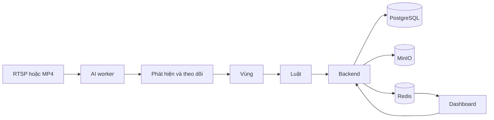

# AI Safety & Compliance Monitoring POC

Hệ thống xem camera nhà máy cà phê, đối chiếu luật an toàn, và tạo incident để người vận hành xác nhận. AI không ra quyết định kỷ luật.

Bản đặc tả gốc nằm ở [docs/SPEC.md](docs/SPEC.md).

## Chạy trên máy

Cần Docker Desktop. Trong thư mục dự án:

```text
copy .env.example .env
docker compose up -d --build
```

Lần đầu sẽ tải image và build, có thể mất vài phút.

Mở:

| Việc | Địa chỉ |
|---|---|
| Dashboard | http://localhost:3000 |
| API Swagger | http://localhost:8000/docs |
| MinIO console | http://localhost:9101 |
| Worker health | http://localhost:8081/health |

Postgres và Redis chỉ chạy trong mạng Docker, không mở cổng ra máy.

Tài khoản demo:

| Người dùng | Mật khẩu | Việc được làm |
|---|---|---|
| admin | admin123 | Camera, vùng, luật |
| safety | safety123 | Duyệt incident |
| viewer | viewer123 | Chỉ xem |

MinIO: `safetyadmin` / `safetyadmin123`.

## Bản đồ hệ thống



Worker xử lý hình tại chỗ. API chỉ nhận incident, ảnh, và cấu hình. Dashboard nhận incident mới qua Server-Sent Events.

## Tình huống mẫu

Dữ liệu khởi tạo có nhà máy Coffee Factory POC, năm camera, tám vùng và bảy luật:

1. Vùng cấm — người đứng trong vùng quá thời gian cấu hình.
2. Hairnet — chỉ trạng thái Không mới tạo incident. Không xác định thì không báo.
3. Đồng phục — chỉ trạng thái Sai mới tạo incident.
4. Vùng nguy hiểm máy — người đi vào polygon của máy.
5. Làn forklift — người đi vào làn. Xe forklift được vẽ để demo; cảnh báo dựa trên người.
6. Dây chuyền hạt — camera `CAM-BEAN-01` có ba băng, hạt chạy từ trên xuống:
   - Hạt xanh: đếm và phân loại good, black, broken, fade, sour. Tỷ lệ lỗi trong cửa sổ gần nhất vượt 15% thì tạo incident.
   - Hạt rang: đếm và phân loại good, quaker, burnt, insect, mould. Cùng ngưỡng 15%.
   - Chỉ đếm: mỗi hạt cộng một lần khi cắt vạch giữa băng, không chấm điểm lỗi.

Trong **AI Mode: DEMO**, worker tự tạo người đi vào từng vùng an toàn, và tự cho hạt chạy trên ba băng. Nhãn hairnet và đồng phục đi theo loại vùng. Hạt demo không cần file model. Banner trên dashboard ghi rõ đang ở DEMO.

Nút **Simulate an incident** trên trang camera giữ người đứng trong vùng vài giây để luật chạy ngay.

## Việc nên thử

1. Đăng nhập `admin`.
2. Mở một camera. Bật **Show AI overlay** để thấy người, vùng, hairnet và đồng phục.
3. Vào **Draw zones**, bấm các góc trên ảnh, lưu polygon.
4. Vào **Rules**, chọn mẫu luật và vùng.
5. Đợi khoảng 20 giây, hoặc bấm Simulate. Incident xuất hiện ở Overview mà không cần tải lại trang.
6. Mở incident, xem ảnh, bấm Confirm, False positive, hoặc Resolve.

Upload MP4 ở trang camera nếu muốn dùng video thật làm nền. Worker phát lại file đó. RTSP điền vào ô stream URL, dạng `rtsp://user:password@địa-chỉ/stream`. Mật khẩu không được ghi ra log và không trả về nguyên văn trên API.

## Vùng và camera bị lệch

Người ở trong vùng khi điểm chân, tức giữa cạnh dưới của khung người, nằm trong polygon. Vùng vẽ được bao nhiêu góc cũng được, miễn các cạnh không cắt nhau. **Redraw** sửa hình vùng tại chỗ, luật và incident cũ vẫn gắn với vùng.

Mỗi vùng lưu khung hình đã dùng để vẽ. Khoảng mỗi giây, worker so khung hình hiện tại với khung đó:

| Kết quả so | Vùng |
|---|---|
| Lệch dưới 1% | Giữ nguyên |
| Lệch 1–20% | Dịch theo camera, nhãn ghi "auto-aligned" |
| Lệch hơn 20%, không khớp, hoặc vùng ra ngoài khung quá 40% | Tạm dừng: không vẽ trên khung hình, luật của vùng không chạy. Tự bật lại khi góc nhìn khớp lại |

Tạm dừng hay bật lại cần hai lần so liên tiếp cùng kết quả.

Camera xoay giữa nhiều góc (PTZ preset) thì bật **Camera has several views** trong Camera settings. Mặc định tắt. Các vùng khóa cùng một khung hình là một góc nhìn: mở Draw zones khi camera đang ở góc đó, vẽ hoặc bấm **Lock to this view** cho từng vùng của góc đó. Worker chỉ dùng góc nhìn khớp nhất với khung hình hiện tại; vùng của góc khác bị ẩn và không chạy luật. Đổi góc cần góc mới khớp hơn ít nhất 25% trong hai lần so liên tiếp. Không bật cho camera cố định: hai vùng vẽ vào hai ngày khác nhau sẽ thành hai góc nhìn và ẩn lẫn nhau. Trang camera có mục **Zones** ghi trạng thái từng vùng. Vùng vẽ trước khi có chức năng này giữ nguyên vị trí; bấm **Lock to this view** trong Draw zones nếu vùng đang khớp với khung hình.

## CPU và GPU

Mặc định chạy CPU. Dashboard không cần GPU.

Mỗi camera chạy model với `AI_THREADS` luồng, mặc định 2, và các luồng nghỉ giữa hai frame. Trên máy 22 luồng CPU, 4 camera đạt khoảng 27 FPS mỗi camera và dùng khoảng 4.5 lõi. Một camera trên máy nhiều lõi có thể tăng `AI_THREADS`; nhiều camera thì giữ thấp. Worker đọc cấu hình camera mỗi giây và gửi trạng thái lên backend hai lần mỗi giây, không theo từng frame.

`AI_MODE=REAL` dùng YOLOX-Nano khi có `models/person.onnx`, nhận diện toàn thân mà không yêu cầu thấy mặt. Cách tải model chính thức và checksum nằm ở [models/README.md](models/README.md). Không có model thì dùng OpenCV HOG. Khi chưa có `ppe.onnx`, hairnet và đồng phục dùng bộ phân loại màu dự phòng, chỉ phù hợp kiểm thử POC.

Đặt file ONNX vào thư mục `models/`:

| File | Hợp đồng |
|---|---|
| `person.onnx` | YOLOX-Nano chính thức: đầu vào 1x3x416x416 BGR 0..255, đầu ra raw 1x3549x85; class COCO 0 là người. |
| `forklift.onnx` | Ra tensor Nx6: x1, y1, x2, y2, score, class trong tọa độ ảnh đầu vào model. Class 1 là forklift. |
| `ppe.onnx` | Ảnh 128x128, 6 logit: hairnet Có/Không/Không xác định, rồi đồng phục Đúng/Sai/Không xác định. |
| `coffee.onnx` | ONNX của YOLO chín lớp: 0 good, 1 black, 2 broken, 3 fade, 4 sour, 5 quaker, 6 burnt, 7 insect, 8 mould. Chấp nhận tensor Nx6 hoặc đầu YOLO Ultralytics `(1, 13, anchors)`. Băng xanh nhận 0–4, băng rang nhận 0 và 5–8, băng đếm nhận mọi class thành một hạt. `prepare_public_beans.py` dựng `data/coffee-yolo` từ ảnh công khai; fade và sour không có lớp tương ứng trong hai bộ đó. Không có file này thì REAL dùng màu và hình dạng. |

GPU trên máy Linux có NVIDIA Container Toolkit:

```text
docker compose -f docker-compose.yml -f docker-compose.gpu.yml up -d --build
```

Image mặc định vẫn là CPU. Muốn inference CUDA thì cài `onnxruntime-gpu` trong image worker và giữ `AI_DEVICE=cuda`.

## Giấy phép model

- OpenCV và bộ HOG phát hiện người: Apache-2.0.
- Theo dõi người: ByteTrack qua thư viện supervision, Apache-2.0.
- ONNX Runtime: MIT.

Không dùng Ultralytics YOLO vì giấy phép AGPL.

## Theo dõi

- `http://localhost:8000/health`, `/ready`, `/metrics`
- `http://localhost:8081/health`, `/ready`, `/metrics`

Metric của worker gồm trạng thái camera, số frame, FPS, độ trễ inference, số phát hiện, số incident, và frame bị bỏ.

Trang Evaluation cho tỷ lệ false positive trên các incident đã được người duyệt. Đó chưa phải độ chính xác của model. Recall cần nhãn các vụ bị bỏ sót, POC này chưa thu thập phần đó.

## Dừng và xóa dữ liệu

Dừng, giữ database và ảnh:

```text
docker compose down
```

Xóa toàn bộ dữ liệu POC, gồm Postgres và MinIO:

```text
docker compose down -v
docker compose up -d --build
```

## Kiểm tra đã chạy

```text
docker compose ps
```

Backend và worker phải healthy. Đăng nhập xong phải thấy 5 camera, gồm Bean Line Camera 01, và các incident mẫu.
